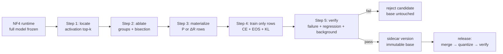

# Q-LAMT

**Row-sparse repair for quantized LLMs.** Locate the rows that fire on a failure, ablate to confirm which rows are causal, train only those rows on the deployed 4-bit model, and publish through a versioned sidecar plus a merge → quantize → verify step.

[](https://github.com/Wyl-cmd/q-lamt/actions/workflows/ci.yml)
[Apache-2.0](LICENSE)

> [中文 README](README.md) · [Chinese technical specification](定点局部训练-技术方案.md) · [Results](RESULTS.md)

## What this is

This is a working research prototype of a **targeted model-repair** pipeline, not a replacement for pretraining or general-purpose fine-tuning.

Given one failure sample (prompt + wrong answer + target answer + paraphrases), it:

1. runs a forward pass on the **deployed NF4 model** and records per-channel activations;
2. groups/zeroes candidate output channels and measures the behavioral move to confirm **causal rows**;
3. attaches a sparse row parameter only to those rows — `delta` (`ΔR`, zero-init around the NF4 working point) or `splice_fp16` (start from the FP16 row);
4. trains on a small replay set with teacher forcing, EOS-terminated targets, background KL, and a previous-version KL/regression set for multi-round sessions;
5. commits a **versioned sidecar** without mutating the base, or merges to FP16 and requantizes at release time, then verifies the deployed function again.

The base ledger is a clean FP16/BF16 model. The runtime is the same NF4 model users would run for inference. The only trainable parameters are the selected rows.

## Results at a glance

All experiments below are on a single RTX 4070 Ti 12GB, with Qwen2.5-0.5B/7B-Instruct in bitsandbytes NF4. These are **constructed mechanism experiments**, not a public benchmark.

| Setting | What was measured | Result |
|---|---|---|
| 0.5B, 12 synthetic failures (identity / fictional facts / agent tool names / strict format) | exact free generation, before and after requantization | **12/12 exact** with EOS targets; **5/12** without EOS (teacher-forced was 12/12) |
| 0.5B, Australia capital | base answered `Sydney`; target `Canberra` | fix 1.0; exact `Canberra` pre/post requant; background KL 0.0093 |
| 7B, Valdoria capital | base answered `Féridon`; target `Mervik` | 64 rows, 105 steps, fix 1.0, exact `Mervik`; release published |
| 7B, identity-maker | target `NGT Labs` (synthetic entity) | 108-row union / 90 steps, fix 1.0, exact `NGT Labs`; Valdoria regression 1.0; release published |
| 7B, Orion founder | target `Elin Marr` | 0.667 at 96 rows / 200 steps; **rejected** by verification |

`NGT Labs` is a synthetic identity target from the historical runs, not the project name.

The 7B NF4 model loads at **5.18 GB allocated**; the training loop peaks at **6.44 GB allocated**; a full fix takes **68–75 s** on the 4070 Ti. The four base shards stay hard-linked to the source model and are byte-identical after the experiments (`samefile`).

## Consumer-GPU reality

This section is deliberately blunt: the memory story is **not** "only the active path is loaded". A dense Transformer needs all layers for each forward/backward pass.

| | 0.5B | 7B |
|---|---:|---:|
| Full NF4 model resident | ~0.43 GB allocated (~0.62 GB reserved) | ~5.18 GB allocated (~5.52 GB reserved) |
| Training peak allocated | ~1.0–1.5 GB | ~6.44 GB |
| Total with ~4 GB desktop use | ~5–5.5 GB | ~10.4 GB |
| Fit on 8 GB? | yes | **not verified**; tight even on a clean card |
| Fit on 12 GB? | yes, comfortably | **measured**, with ~1.5 GB headroom |
| Full fine-tune comparison (7B) | — | >100 GB with FP32 Adam states |
| QLoRA comparison (7B) | — | ~5–7 GB; **same order of magnitude** |

What is resident during a fix:

- **Yes:** all NF4 weights (the whole model), activation graph for backward, the selected row parameters and their optimizer state (0.1–10 MB), temporary per-tensor dequant buffers during setup.
- **No:** the full FP16/BF16 base (kept on disk and read row-wise), full-model weight gradients, optimizer states for the frozen base, or a persistent BF16 copy of every named layer.
- **Not possible:** loading only the "activated path". At each layer every row reads the full activation vector produced by the previous layer; the activated rows are a *training mask*, not a runnable sub-network. The map tells you which rows may change, not which weights can be omitted from the forward pass.
- **Session-level unload:** yes. The model is loaded once per fix/batch, then released; unloading between locate, ablate, and train would require re-running the forward and is counterproductive.

The practical advantage over full fine-tuning is large (6.4 GB vs >100 GB). Over QLoRA, the memory advantage is modest; the differentiators are deployment consistency, row-level audit/rollback, versioned sidecars, and data economics. See [docs/VRAM.en.md](docs/VRAM.en.md) for the full accounting and the 0.5B/7B measurements.

## Pipeline



Detailed math, per-step necessity, and failure modes are in [docs/TECHNICAL.en.md](docs/TECHNICAL.en.md).

## Quick start

Requirements: Python 3.10+, a CUDA GPU for NF4 (CPU is enough for the unit tests), ~20 GB disk for the 0.5B experiment (7B needs ~15 GB weights plus release artifacts).

```bash
git clone https://github.com/Wyl-cmd/q-lamt.git
cd q-lamt

bash scripts/setup_env.sh          # project-local .venv; CUDA torch
bash scripts/download_model.sh     # Qwen2.5-0.5B-Instruct by default

.venv/Scripts/python -m pytest -q  # Windows
# .venv/bin/python -m pytest -q    # Linux/macOS

.venv/Scripts/python -m qlamt.cli info --config configs/smoke.json
.venv/Scripts/python -m qlamt.cli fix --failure failures/smoke.json --config configs/smoke.json
```

For 7B:

```bash
MODEL_ID=Qwen/Qwen2.5-7B-Instruct \
LOCAL_DIR=models/Qwen2.5-7B-Instruct \
bash scripts/download_model.sh

.venv/Scripts/python -m qlamt.cli fix --failure failures/valdoria.json --config configs/7b.json
```

Multi-round sidecar + release:

```bash
.venv/Scripts/python -m qlamt.cli fix --failure failures/valdoria.json --config configs/7b.json
.venv/Scripts/python -m qlamt.cli fix --failure failures/identity-maker.json --config configs/7b.json \
  --set lr=0.001 --set guard_ratio=2.0 --set cum_guard=4.0
.venv/Scripts/python -m qlamt.cli release --version <version_id> --config configs/7b.json
.venv/Scripts/python -m qlamt.cli versions --config configs/7b.json
```

Windows uses `.venv/Scripts/python.exe`; Linux/macOS uses `.venv/bin/python`. If CUDA is unavailable, use `configs/smoke.json` with `quant="none"` for a CPU-only tiny-model sanity check (the real experiments require NF4/CUDA).

## Repository layout

```text
qlamt/                 runtime, locate, ablate, ledger, train, version store, release, CLI
tests/               17 CPU tests (hook equivalence, ablation, splice, versioning, sharding)
experiments/         probe / dataset runner / summary combiner
configs/             0.5B, 7B, multi-round, spec-aligned configs
data/                small constructed failure set (12 items)
failures/            Australia, Valdoria, Orion, identity examples
scripts/             environment, model download, smoke, health check
sample_reports/      selected JSON reports/manifests (no weights)
docs/                technical / VRAM / comparison documents
RESULTS.md           0.5B and 7B experimental results
定点局部训练-技术方案.md  L-1.1 Chinese technical specification
```

## Advantages

- **Data economics:** one failure plus ≥5 paraphrases, not a domain dataset. Useful when collecting thousands of examples is the bottleneck.
- **Deployment consistency:** locate, ablate, train, and verify happen on the deployed NF4 function; release requantizes and verifies the shipped artifact. Training an FP16 adapter and hoping it survives quantization is a different risk profile.
- **Row-level audit and rollback:** every edit carries `(layer, row)`, a manifest, a base SHA, a config hash, and a version chain. You can inspect exactly what changed and switch `current` back without touching the base.
- **Forgetting control by construction:** 99.9% of the model is frozen; background KL, previous-version KL, and a regression set are explicit checks, not an afterthought.
- **No adapter accumulation:** a release can be a single merged model; multi-task LoRA serving stacks are avoided.
- **Causal gating:** activation magnitude is a recall device; ablation is the filter for "bright but not responsible". This is more targeted than training a full low-rank adapter.
- **Domain reuse:** homogeneous failures overlap on rows; a domain becomes a versioned sidecar rather than a new adapter per task.

## Disadvantages and honest limits

- **Not a small edit in magnitude.** On our constructed tasks, 0.5B needed 2.3–4.6× row-norm changes; 7B needed 1.61–2.28× cumulative. The parameter *count* is tiny, but the per-row displacement is not. The spec's 15%/30% guards are **not met** by these results.
- **Not every target is fixable with the current budget.** 7B Orion reached 0.667 and was rejected. The mechanism is sound; the target difficulty/row budget still decides.
- **Single-fix cost is higher than ROME/MEMIT.** Hundreds of ablation forwards and a training loop per failure. For a single isolated fact with no need for paraphrase generalization or audit, a closed-form editor is cheaper.
- **A full domain-training run is cheaper with QLoRA.** The per-failure locate/ablate step does not amortize as well as one domain LoRA over a large dataset.
- **VRAM is not a breakthrough over QLoRA.** 7B NF4 peaks at 6.44 GB; QLoRA is the same order. The advantage is governance/data/deployment consistency, not a new memory regime.
- **Quantization is still real.** Training `splice_fp16` around FP16 rows and then releasing NF4 re-introduces one quantization step. Release verification is mandatory; the repository currently targets NF4, not MXFP4.
- **Evaluation is narrow.** 12 constructed 0.5B items, two accepted 7B targets, 16 short background prompts; no MMLU/IFEval-scale neighborhood evaluation. The 20–50 sequential-fix experiment is not done.
- **Complexity.** A LoRA file is simpler to ship than a version store + sidecar + release pipeline. The extra machinery buys auditability and multi-round safety.

The full comparison (full fine-tuning, QLoRA/LoRA, ROME/MEMIT, FISH, activation steering, RAG) and a step-by-step necessity analysis are in [docs/COMPARISON.en.md](docs/COMPARISON.en.md).

## Tests

```bash
.venv/Scripts/python -m pytest -q          # 17 tests
.venv/Scripts/python -m ruff check qlamt tests experiments --select F,E9
bash scripts/check.sh                      # tests + config validation
```

CI runs the CPU test suite on Python 3.10/3.11.

## Model weights and licenses

This repository does **not** ship model weights. The Qwen2.5 weights are downloaded separately and retain their own license. The code is Apache-2.0 (see [LICENSE](LICENSE)); runtime dependencies retain their own licenses. If you publish experimental results, cite this repository and the exact base model/config hash.

## Status

`v0.1` research prototype. The core single-fix and multi-round sidecar/release loops run end-to-end on 0.5B and 7B. The remaining productization gaps are explicit: enforce/calibrate the norm budget, run 20–50 sequential fixes, test a real MXFP4 release, test the single-file 15 GB sharding path, and add OS-level locking/CI beyond the current parent-pointer check.

## Acknowledgements

With thanks to **ST**.
